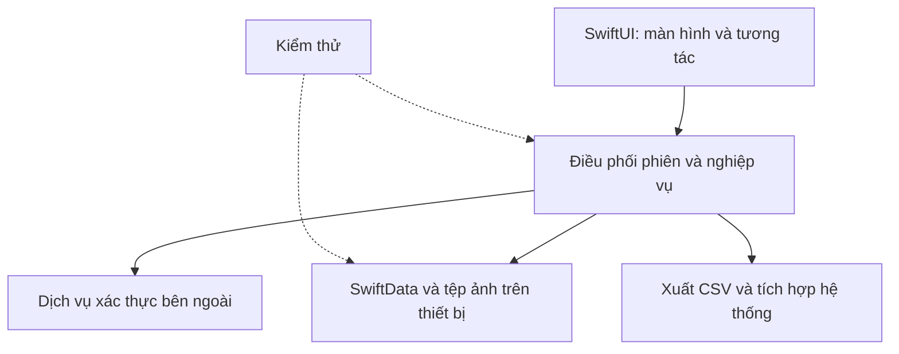

# SnapSpend — Báo cáo kỹ thuật và quá trình phát triển

Ngày cập nhật: **04/11/2026**  
Phạm vi: ứng dụng iOS SnapSpend, codebase `ViAnh`  
Mục tiêu: hồ sơ dự án GitHub, portfolio và chuẩn bị phát hành

## 1. Cơ sở và giới hạn báo cáo

Báo cáo sử dụng sáu tài liệu được chủ dự án cung cấp: `README.md`, `PROGRESS.md`, `TESTING.md`, `REQUEST.md`, `requirements.txt` và `skills-lock.json`. Các tên README/TESTING có hậu tố khi tải lên được chuẩn hóa về tên trong repository.

Chưa có source Swift, project Xcode, build log hoặc `.xcresult` mới để kiểm tra trực tiếp. Vì vậy, các mô tả sửa lỗi và kết quả 10 tests dưới đây là **thông tin do tài liệu dự án báo cáo**, không phải kết quả chạy lại độc lập khi biên soạn. Phân biệt này giúp người đọc hiểu đúng giá trị và giới hạn của bằng chứng.

## 2. Bài toán sản phẩm

Người dùng có thể quên ngữ cảnh của một khoản chi khi chỉ lưu con số và ngày. SnapSpend kết hợp ghi chi tiêu với hình ảnh để hỗ trợ xem lại lịch sử theo cách gần với nhật ký cá nhân.

Luồng mục tiêu: mở app → chụp hoặc chọn ảnh → nhập số tiền → chọn danh mục → lưu. “3 giây” là định hướng giảm thao tác; chưa có dữ liệu đo để công bố như cam kết hiệu năng.

Ứng dụng hướng đến iPhone, thao tác một tay và lưu trữ cục bộ. Màu Warm Cream và xanh lá tiếp tục là định hướng của SnapSpend; chủ đề hồng thuộc dự án khác.

## 3. Phạm vi phiên bản

| Nhóm | Chức năng được tài liệu mô tả | Điểm cần kiểm chứng |
| --- | --- | --- |
| Giao dịch | Tạo, đọc, sửa, xóa khoản chi; liên kết ảnh | Validation, chống lưu lặp, cập nhật danh sách |
| Nhật ký | Ảnh theo ngày và lịch sử giao dịch | Ngày giao dịch khác ngày chụp khi cần |
| Ngân sách | Hạn mức và trạng thái chi tiêu | Chưa đặt hạn mức khác chi tiêu bằng 0 |
| Xác thực | Google, Apple, khách và phục hồi phiên | Chuyển tài khoản thực tế và vòng đời app |
| Hồ sơ | Chọn/cắt/xóa avatar | Lưu đĩa, cache và người sở hữu |
| Xuất dữ liệu | CSV và tiếng Việt | Ký tự đặc biệt, cột, lọc người dùng |
| Cá nhân hóa | Việt/Anh, sáng/tối | Toàn bộ màn hình, chữ lớn, tương phản |

Model `Wallet` và số dư được nhắc đến trong test, nhưng không đủ căn cứ kết luận màn hình quản lý ví vẫn nằm trong sản phẩm. OCR, kết nối ngân hàng và đồng bộ chi tiêu qua thiết bị chưa được xác lập trong phạm vi báo cáo.

## 4. Công nghệ và cấu trúc trách nhiệm

| Công nghệ | Mục đích |
| --- | --- |
| SwiftUI | Hiển thị màn hình và tương tác |
| SwiftData | Lưu các thực thể nghiệp vụ cục bộ |
| Swift Concurrency | Xử lý tác vụ nền và điều phối cập nhật |
| Swift Testing | Kiểm thử tự động theo tài liệu mới |
| Firebase Authentication | Xác thực người dùng |
| TestFlight | Phân phối beta để nhận phản hồi |

Các thư mục mang tên Frontend, Backend, API và Security là cách nhóm trong tài liệu hiện tại. Chưa có source để đánh giá ranh giới phụ thuộc, mức độ dependency injection hoặc việc tách module.

Đặc biệt, SwiftData và tính ngân sách trên iPhone là logic/lưu trữ phía client. CSV là xuất dữ liệu, local notification là tích hợp nền tảng; không nên gộp chúng vào “API mạng” chỉ để tạo đủ bốn tầng.

Repository [nalexn/clean-architecture-swiftui](https://github.com/nalexn/clean-architecture-swiftui) là nguồn tham khảo về tách Presentation, Business Logic và Data Access. Với SnapSpend, chỉ nên công bố đã áp dụng nguyên tắc nào khi có source chứng minh. Không cần sao chép toàn bộ kiến trúc của ví dụ để có một dự án tốt.

### Sơ đồ trách nhiệm khái niệm

Sơ đồ mô tả trách nhiệm để thảo luận; không khẳng định đây là sơ đồ import hoặc dependency chính xác của source hiện tại.

## 5. Dữ liệu và ranh giới chủ sở hữu

Các thực thể được tài liệu nêu gồm `ExpenseItem`, `ExpenseCategory`, `MonthlyBudget` và `Wallet`. Ảnh và thumbnail được lưu thành tệp, còn giao dịch giữ tham chiếu tới ảnh.

| Loại dữ liệu | Quy tắc mong muốn |
| --- | --- |
| Khoản chi | Truy vấn và thay đổi trong phạm vi chủ sở hữu |
| Ngân sách | Không dùng hạn mức tài khoản khác |
| Danh mục tùy chỉnh | Riêng theo tài khoản; danh mục mặc định theo quy tắc sản phẩm |
| Avatar | Tách cả khóa, tệp và cache |
| Phiên khách | Có chính sách riêng; không tự nhận dữ liệu lịch sử không rõ chủ |
| Kết quả tác vụ nền | Chỉ áp dụng nếu phiên liên quan còn phù hợp |

Kiểm tra `ownerUID` trên câu truy vấn chưa đủ chứng minh toàn bộ luồng UI an toàn. Cần kiểm tra thêm state đã tải trước đó, sheet đang mở, cache ảnh, callback nền và tác vụ xuất file. Tương tự, đăng nhập Firebase không tạo cơ chế sao lưu cho cơ sở dữ liệu SwiftData.

## 6. Case study: dữ liệu nhiều tài khoản

### Vấn đề

Lịch sử trao đổi ghi nhận dữ liệu chi tiêu tài khoản cũ từng còn xuất hiện sau khi đổi tài khoản. Tài liệu hiện mô tả cơ chế lọc theo chủ sở hữu và test A/B, nhưng chưa kèm implementation để xem mọi điểm đọc/ghi đã dùng cùng quy tắc hay chưa.

### Giải pháp được mô tả

- Phân biệt dữ liệu bằng `ownerUID`.
- Truy vấn khoản chi, ngân sách và danh mục trong phạm vi người dùng.
- Tạo khóa avatar khác nhau theo định danh.
- Giữ riêng dữ liệu lịch sử chưa xác định chủ sở hữu.

### Cách xác minh

Tạo dữ liệu A = 35.000 ₫ và B = 50.000 ₫ trong database test. Kiểm tra tổng của từng người và trạng thái tài khoản mới. Sau đó thực hiện đăng xuất/đăng nhập trên app thật, mở lại ứng dụng và kiểm tra Dashboard, nhật ký, ngân sách, danh mục, avatar và CSV.

### Giới hạn

Test lọc dữ liệu bằng UID và test khóa avatar không thay thế kiểm thử toàn bộ quá trình chuyển phiên. Cần liên kết code và test tại commit cụ thể trước khi dùng case study như bằng chứng triển khai hoàn chỉnh.

## 7. Case study: ảnh mồ côi khi đổi phiên trong lúc lưu

### Vấn đề được tài liệu mới ghi nhận

Trong `ExpenseCaptureView.swift`, ảnh có thể được lưu xong trên đĩa, nhưng phiên đã đổi trước khi giao dịch hoàn tất. Nhánh hủy thoát mà không thu hồi ảnh gốc và thumbnail sẽ để lại tệp không được giao dịch tham chiếu.

### Bản sửa được tài liệu mô tả

Bổ sung gọi `ImageStorageService.shared.delete(imageFileName:thumbnailFileName:)` trong nhánh phát hiện phiên không còn hợp lệ. Mục đích là thu hồi các tệp vừa tạo khi thao tác lưu bị bỏ.

### Regression test cần có

1. Dùng kho ảnh tạm và cơ chế điều khiển thời điểm hoàn tất tác vụ.
2. Bắt đầu tạo khoản chi của A và chờ ảnh được ghi.
3. Đổi phiên sang B trước bước hoàn tất giao dịch.
4. Cho tác vụ cũ tiếp tục.
5. Kiểm tra không có giao dịch mới của B từ tác vụ A, không còn ảnh tạm bị bỏ và UI không cập nhật bằng kết quả cũ.

Test CRUD/xóa ảnh thông thường chỉ chứng minh API lưu/xóa trong tình huống đó. Nó chưa đủ để khẳng định thứ tự tác vụ khi đổi tài khoản đã được kiểm thử. Nên kiểm tra thêm lỗi lưu metadata, lỗi xóa file và task cancellation.

### Giá trị kỹ thuật

Đây là tình huống phù hợp để trình bày về sự nhất quán giữa database và file system: hai nơi lưu không tự hình thành một giao dịch nguyên tử. Ứng dụng cần quy tắc hoàn tất và thu hồi khi một bước bị gián đoạn.

## 8. Case study: khởi động và chế độ khách

PROGRESS và TESTING ghi nhận `loadSession()` từng tự gọi chế độ khách khi không có phiên, làm người mới cài bỏ qua màn hình chào mừng. Bản sửa được mô tả giữ `currentUser = nil` và hiển thị màn hình xác thực cho đến khi người dùng chọn đăng nhập hoặc dùng thử.

Cần kiểm tra ít nhất: cài mới trên thiết bị test, có phiên hợp lệ, phiên hết hiệu lực, đã đăng xuất, đã chọn khách và mở lại app. Phân biệt “không có phiên” với “người dùng chủ động chọn khách” giúp trạng thái khởi động rõ ràng hơn.

Không xóa app chứa dữ liệu cần giữ chỉ để thử fresh install; ưu tiên thiết bị test, Simulator hoặc bản cài thử riêng.

## 9. Kết quả kiểm thử và độ tin cậy của bằng chứng

Tài liệu mới báo cáo **10 tests trong 8 suites**, Debug và Release build thành công. README cũ vẫn ghi **30 XCTest và 45 kịch bản đạt 100%**, nên cần thay bằng thông tin thống nhất.

| Suite theo tài liệu mới | Số hàm test | Phạm vi được mô tả |
| --- | --- | --- |
| MonthlyExpenseCalculationTests | 1 | Tổng chi, chủ sở hữu, ranh giới tháng |
| DataIsolationTests | 1 | Dữ liệu A/B và tài khoản mới |
| BudgetStatusCalculationTests | 1 | Các trường hợp ngân sách |
| CSVExportTests | 1 | Ký tự đặc biệt và phạm vi dữ liệu |
| TransactionLifecycleAndImageStorageTests | 1 | CRUD và tệp ảnh |
| EntityIsolationAndWalletTests | 1 | Danh mục, ngân sách và số dư |
| StreakCalculationTests | 1 | Chuỗi ngày ảnh camera |
| SecurityAndDataPreservationTests | 3 | PKCE/nonce, khóa avatar và dữ liệu cũ |
| **Tổng** | **10** | **Theo tài liệu, chưa chạy lại độc lập** |

Ma trận 45 TC cần phân biệt test một phần với test đầu cuối. Các điểm đáng chú ý:

- TC-05: khóa avatar khác nhau chưa chứng minh ảnh đang hiển thị được thay đúng trên UI.
- TC-08/41/44: helper PKCE/nonce đúng chưa chứng minh request, callback và đăng nhập thực tế đúng.
- TC-10/12/13: query A/B đúng chưa chứng minh khôi phục và thay đổi session đúng.
- TC-24/26: tệp tồn tại chưa chứng minh chất lượng nén, kích thước thumbnail và bộ nhớ đạt mục tiêu.
- TC-32: lọc danh mục riêng chưa chứng minh quy tắc bảo vệ danh mục mặc định.
- TC-43: danh sách 10 hàm chưa thể hiện test riêng tái hiện thay phiên trong lúc lưu.

Về môi trường, chuỗi “Xcode 16.2 / SDK iOS 26.2” cần được xác minh bằng lệnh trên máy thực tế. Không dùng UUID Simulator hoặc đường dẫn DerivedData của một máy làm cấu hình bắt buộc cho người khác.

## 10. Hiệu năng, quyền riêng tư và phát hành

Chưa có trace hiệu năng để kết luận FPS, RAM, dung lượng ảnh cố định hoặc thời gian thao tác. Kế hoạch đo nên ghi rõ thiết bị, hệ điều hành, build, dữ liệu đầu vào, số lần đo và công cụ.

Ưu tiên đo luồng chụp/lưu ảnh, cuộn nhật ký nhiều thumbnail và đổi tab. Phân biệt thời gian người dùng thao tác với độ trễ xử lý sau khi bấm Lưu.

Danh sách kiểm tra trước phát hành gồm: camera và quyền bị từ chối, đăng nhập Google/Apple, khôi phục phiên, avatar, đổi tài khoản, CSV, xóa tài khoản và thao tác khi mất mạng. Xóa tài khoản cần xác minh cả danh tính từ xa khi áp dụng; chỉ xóa dữ liệu cục bộ chưa đủ kết luận toàn bộ quy trình hoàn tất.

Local-first không có nghĩa không truyền dữ liệu ra ngoài: luồng xác thực và tỷ giá có thể dùng mạng. Khai báo quyền riêng tư phải phản ánh code và các SDK thực sự sử dụng. Báo cáo này không phải chứng nhận tuân thủ hoặc đánh giá pháp lý.

## 11. Đóng góp cá nhân và sử dụng công cụ

Chủ portfolio là Minh Huy theo thông tin cung cấp. Cần xác nhận phần việc cá nhân và ghi nhận người cùng làm trước khi công khai. Không dùng tên chủ tài khoản Developer thay cho tên tác giả mặc định.

Claude Code, Gemini/Antigravity và ChatGPT đã được dùng hỗ trợ trong quá trình trao đổi. Đối với portfolio, nên ghi rõ AI hỗ trợ lập kế hoạch, viết code hoặc rà soát ở mức nào; người phát triển chịu trách nhiệm hiểu giải pháp, kiểm tra thay đổi và xác minh kết quả.

`skills-lock.json` ghi một skill `swiftui-pro` từ `twostraws/swiftui-agent-skill`. File này chứng minh cấu hình ghi nhận skill, không tự chứng minh những hành động đã chạy. Danh sách Python trong `requirements.txt` nên được đặt trong phần công cụ hỗ trợ khi đã xác định script dùng tới; nó không phải công nghệ backend được chứng minh của SnapSpend.

## 12. Hạn chế và kế hoạch hoàn thiện

| Ưu tiên | Hành động | Bằng chứng hoàn tất |
| --- | --- | --- |
| P0 | Xác minh chuyển tài khoản và lưu ảnh đang chạy | Test điều khiển thứ tự tác vụ và chạy trên app |
| P0 | Hoàn tất checklist xác thực/xóa tài khoản | Biên bản với tài khoản test, không dùng dữ liệu cá nhân |
| P1 | Đối chiếu 10 tests với source và 45 TC | Bảng mapping và `.xcresult` đúng commit |
| P1 | Kiểm tra môi trường và build log | Output công cụ và môi trường được ghi chính xác |
| P1 | Kiểm tra test ảnh dùng thư mục tạm | Source cấu hình storage và bằng chứng không ảnh hưởng dữ liệu thật |
| P1 | Thêm ảnh/video demo | Tệp demo khớp phiên bản, không lộ thông tin cá nhân |
| P2 | Tối ưu và đo hiệu năng | Trace hoặc báo cáo đo tái hiện được |
| P2 | Tạo CI nếu phù hợp | Workflow thật và đường dẫn lần chạy |

Không kết luận “0 lỗi chặn phát hành” chỉ từ việc compiler và unit test không báo lỗi. Việc sẵn sàng phát hành còn phụ thuộc các luồng thủ công và cấu hình dịch vụ chưa được kiểm tra.

## 13. Cách trình bày trong hồ sơ ứng tuyển

Ưu tiên liên kết GitHub, demo và trạng thái TestFlight/App Store thực tế. Tập trung vào quyết định có thể giải thích: dữ liệu local-first, kiểm soát chủ sở hữu, xử lý tác vụ nền, vòng đời tệp ảnh và test nghiệp vụ.

Những ý có thể dùng sau khi đối chiếu source và bằng chứng:

- Xây dựng ứng dụng iOS ghi chi tiêu bằng ảnh với SwiftUI và SwiftData.
- Triển khai truy vấn dữ liệu theo tài khoản và kiểm thử ngân sách, ranh giới tháng, CSV.
- Xử lý thu hồi ảnh khi phiên người dùng thay đổi trong lúc lưu bất đồng bộ.
- Viết và chạy bộ kiểm thử Swift Testing; công bố số lượng đúng kết quả đã xác minh.
- Phân phối beta qua TestFlight; chỉ thêm “Published on the App Store” khi đã phát hành thật.

Không dùng số lượng test thay cho coverage. Không ghi “tự xây dựng toàn bộ”, “Clean Architecture” hoặc số liệu tối ưu hiệu năng khi chưa có căn cứ. Chuẩn bị giải thích một đoạn code production và test tương ứng cho mỗi ý kỹ thuật trên CV.

## 14. Tài liệu tham khảo

1. Sáu tài liệu SnapSpend được cung cấp ngày 04/11/2026.
2. [nalexn — Clean Architecture for SwiftUI](https://github.com/nalexn/clean-architecture-swiftui), tham khảo nguyên tắc phân chia trách nhiệm.
3. [Apple — Xcode 16.2 Release Notes](https://developer.apple.com/documentation/xcode-release-notes/xcode-16_2-release-notes), dùng kiểm tra mâu thuẫn phiên bản SDK trong tài liệu.

Báo cáo không sao chép mã nguồn từ repository tham khảo và không tự cấp giấy phép cho SnapSpend.
